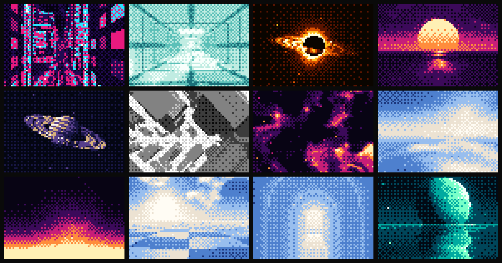

# Dither



Forked from [Retro Loops](https://github.com/rauchg/retro-loops).

Browse 55 animated scenes in the left sidebar. Pick a palette and save the current frame as a PNG, or record a six-second clip or seamless loop in MP4 or WebM with an optional soundtrack. Add, paste, or drop an image to frame it in the scene.

The original was built with [fx](https://fx.sh).

The app runs without a build step or framework.

## How it works

Every effect is a pure scalar field:

```js
fn(u, v, t) -> [0, 1)
```

`u` and `v` are centered screen coordinates, `t` is seconds. The renderer evaluates that field per pixel, then:

1. **Quantizes** the value into 4 levels.
2. **Dithers** with a 4×4 Bayer matrix, so the `0..1` gradient becomes a stable dot pattern instead of banding.
3. **Maps** each of the 5 resulting indexes to a color from a 5-stop palette.
4. Renders at quarter resolution and upscales with `imageSmoothingEnabled = false`, which gives the chunky pixel grid its retro texture.

Because a scene is just a function, a whole new style is ~20–80 lines of math: signed distance fields for architecture, domain-warped value noise for clouds and nebulae, and DDA raymarching/raycasting for the first-person rooms.

Audio is decoded with Web Audio and routed through `MediaStreamAudioDestinationNode`, then muxed with `canvas.captureStream()` into `MediaRecorder`, so exported clips carry sound.

## Effects (55)

| Category | Effects |
| --- | --- |
| `classic` | `vortex` `plasma` `tunnel` `aurora` `metaballs` `grid` |
| `skies` | `clouds` `godrays` `sunslice` `storm` `cumulus` |
| `planets` | `saturn` `eclipse` `jupiter` `moons` `oceanworld` |
| `space` | `starfield` `blackhole` `galaxy` `pulsar` `nebula` |
| `dreamcore` | `poolrooms` `portals` `dreamfield` `arches` `halo` `memory` |
| `impossible` | `droste` `escher` `atrium` `backrooms` `mirrors` `labyrinth` `tokyo` |
| `trading cards` | `holo-vault` `foil-swamp` `booster-break` `mana-table` `final-draw` |
| `stash` | `save-point` |
| `gaming` | `arcade-after-hours` `boss-door` `crt-inventory` |
| `warehouse` | `dock-07` `conveyor-merge` `pick-to-light` `label-run` `high-bay` `night-shift` `sealed-stock` `packout` |
| `epic` | `emerald-ring` `worldship` `dyson-sphere` `eclipse-convoy` |

Standouts:

- **`droste`** — Escher's *Print Gallery*, a logarithmic conformal spiral where the map tiles exactly on itself.
- **`escher`** — *Relativity* staircases folded along three perpendicular gravity axes.
- **`backrooms`**, **`labyrinth`**, **`tokyo`** — 2D DDA raycasters with perspective-correct floors, ceilings, wet reflections and neon signage.
- **`atrium`**, **`mirrors`** — 3D SDF scenes: an endless balcony shaft, and a Kusama infinity room.

The Trading cards, Gaming, Warehouse, and Epic scenes have six-second cycles. Save Point in Stash has an eighteen-second cycle.

## Palettes (17)

`sunset` `cyan` `ember` `synth` `phosphor` `mono` `daydream` `poolrooms` `deepspace` `ochre` `tokyo` `iridescent` `frost` `sodium` `signal` `emerald` `stashtab`

Each scene starts with its own palette. Pick another from the Palette menu or press `p` to cycle through them.

## Controls

| | |
| --- | --- |
| Scene sidebar | browse by thumbnail and category |
| `←` `→`, click canvas | previous / next scene |
| `↑` `↓` while focused in the sidebar | previous / next scene |
| `p` | next palette |
| Add image, paste, or drop an image | frame a screenshot |
| Save PNG | download the current frame with any added image |
| Export Hero | choose resolution, frame rate, and dither cell size and download a hero ZIP |
| `−` `+` | shrink / grow the background margin |
| `♪` | preview the selected soundtrack |
| `● 6s` / `↻ Loop` | record a six-second clip or a seamless loop at the scene’s loop length |

## Export a landing-page hero

With FFmpeg installed, run `npm run dev` or `npm run preview` and choose **Export Hero** beside **Save PNG**. The ZIP uses the current scene and palette at the chosen resolution, frame rate, and cell size. Hero encoding runs on the local Dither server. FFmpeg needs `libvpx-vp9` and `libx264`. If it lives outside your PATH, set `FFMPEG_PATH` when starting the server.

The same exporter is available from the command line. To select a specific FFmpeg binary here, pass `--ffmpeg /path/to/ffmpeg`.

```sh
npm run export:hero
npm run export:hero -- --scene save-point --palette stashtab --width 2560 --height 1440
```

The default export renders the Save Point loop at 1920 × 1080 and 24 fps. It scales a 480 × 270 field by exactly 4× with nearest-neighbor sampling to keep the dither cells crisp. You can set `--width`, `--height`, `--fps`, and `--pixel-size` independently. Both dimensions must be even and divisible by the pixel size. Use `--out` to choose a destination.

The export writes silent VP9 WebM and H.264 MP4 loops, a desktop PNG poster, a 960 × 1200 mobile poster, and `preview.html` into `tmp/hero/<scene>-<palette>/` by default. The preview serves the poster first and lists the smaller video source first. Desktop playback starts after the page loads when the hero is visible and motion is allowed. The mobile and reduced-motion versions use the poster. The media fits inside the hero so features near its edges stay visible. Use the preview’s markup and styles as an integration example.

## URL parameters

- `#<effect>` or `?e=<effect>` — open on an effect, e.g. `?e=tokyo#tokyo`
- `?p=<palette>` — override the palette, e.g. `?e=saturn&p=mono`
- `?a=<track|none>` — soundtrack: `liminal-poolrooms`, `vhs-daydream`, or `none`

Opening a URL with audio selected shows a **click to start** gate: it pre-decodes the track behind a still frame, then starts the motion and the music on the same frame, so nothing is out of sync.

## Soundtracks

Two instrumental dreamcore loops composed with Suno and shipped in `audio/`:

- `Liminal Poolrooms` — warm detuned Rhodes, underwater bells, cavernous reverb
- `VHS Daydream` — tape-wobbled analog arpeggios, music-box celesta, lo-fi hiss

You can also drop in your own audio file; it plays and records the same way.

## Project structure

```text
index.html          markup, UI, styles
app.js              canvas, image and video export, audio, URL/state handling
render.js           shared dither renderer
scene-picker.js     scrollable scene list and thumbnails
palettes.js         17 five-stop palettes
og.png              1200×630 collage used for the social card
effects/
  index.js          stitches every category together into one ordered list
  noise.js          shared math: clamp, smoothstep, hash, value noise, fbm, ridged noise
  classic.js        6   abstract fields
  skies.js          5   clouds, rays, sun, storm, cumulus
  planets.js        5   saturn, eclipse, jupiter, moons, ocean world
  space.js          5   starfield, black hole, galaxy, pulsar, nebula
  dreamcore.js      6   poolrooms, portals, dreamfield, arches, halo, memory
  impossible.js     7   droste, escher, atrium, backrooms, mirrors, labyrinth, tokyo
audio/              two instrumental loops
```

Add a scene in `effects/` with `{name, cat, pal, fn}` and register it in `effects/index.js`. Use a unique URL-friendly `name`, the category as `cat`, and the default palette index as `pal`. Add an optional `label` if the display name needs spaces. The sidebar renders its thumbnail from the same function used in the main preview. Edit or add five-color palettes in `palettes.js`.

## Running locally

No build step needed — the ES modules just need HTTP, not `file://`:

```bash
npm run dev            # serve Dither and its local hero exporter on port 8420
# open http://127.0.0.1:8420
```

## Building

Install the build dependency, then use `npm run build` to bundle the modules and write `dist/`.

```bash
pnpm install --frozen-lockfile
npm run build          # dist/index.html + dist/audio + dist/og.png
npm run preview        # build, then serve dist/ on :8420
```

The bundle and CSS are inlined, so the built page is a single HTML request plus the audio files. Local development never needs this step.

## Deployment

Run `npm run build` and serve `dist/` from any static host.
